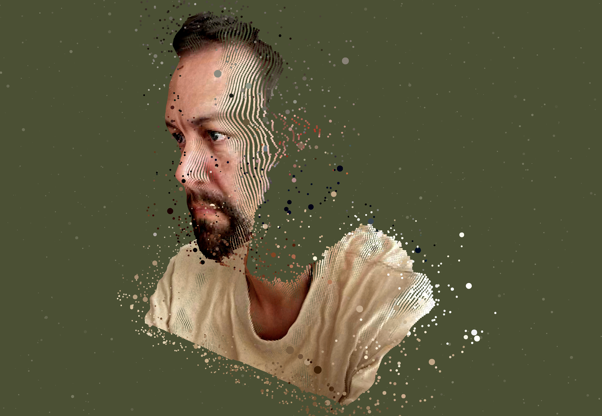

### Hi, I'm Jon 👋

Product designer who simplifies complex RegTech, EventTech and PropTech products: client onboarding, identity verification, booking engines and the design systems underneath them.

I design experiences that reveal the value hidden inside complex products or services, from research to release.

#### Current focus

Bespoke AI tooling for creative work and product development.

- Improving the context for a Claude-powered copilot for an existing client
- A sentiment tracker
- A homepage segmentation reporting tool
- Bespoke creative tooling: small, focused tools built for one job, like [Showboard](https://jonleverrier.com/notes/introducing-showboard)

#### Recent work

**[White Paper](https://jonleverrier.com/case-study/white-paper-booking-engine-design-development)** · EventTech
Consolidated legacy systems into one booking platform and back office. 90% of bookings now happen online, booking admin is down 75% and checkout takes 55% fewer clicks. The back office went from four people to one.

**[Vaiie Identify](https://jonleverrier.com/case-study/vaiie-identify-product-design)** · RegTech
Redesigned the identity verification journey around its sticking points and unhappy paths. Successful verifications went up 4x without changing the vendor's technology, and Vaiie became a government-approved digital identity platform.

#### Side projects

- **[StreetPal](https://jonleverrier.com/case-study/streetpal-ios-app-design-development)**: a native iOS walking app for street photographers, built in Swift with MapKit, WeatherKit and HealthKit. It's in beta now.
- **[craft-breadcrumb](https://github.com/youandmedigital/craft-breadcrumb)**: a Craft CMS 5 plugin that generates a simple breadcrumb array for you to style in Twig. It handles multisite and different element types, and can output `BreadcrumbList` schema.
- **[Showboard](https://jonleverrier.com/notes/introducing-showboard)**: a free browser tool that turns screenshots into an angled presentation shot, with PNG export up to 5000px. Everything runs in your browser.

#### Stats

  
  

#### Connect

[Website](https://jonleverrier.com) · [Book a call](https://cal.com/jonleverrier/intro) · [LinkedIn](https://www.linkedin.com/in/jonleverrier) · [Malt](https://www.malt.com/profile/jonleverrier) · [Instagram](https://www.instagram.com/jonleverrier) · [Flickr](https://www.flickr.com/photos/jonleverrier)
